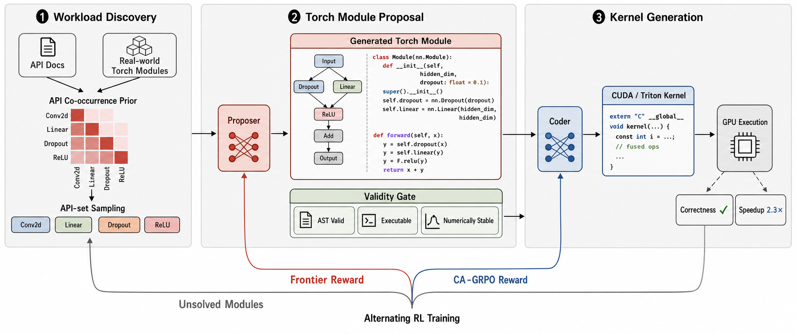
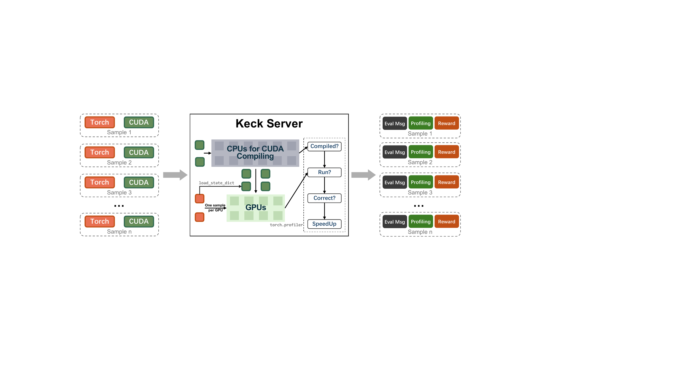

# KernelZero: Co-Evolving Proposer and Coder for Continuously Improved GPU Kernel Generation

[](https://arxiv.org/abs/2609.33074)
[](https://huggingface.co/kcxain/KernelZero-CUDA-7B)
[](https://huggingface.co/kcxain/KernelZero-CUDA-SFT-7B)
[](https://huggingface.co/datasets/kcxain/KernelZero-CUDA-SFT)
[](LICENSE)

KernelZero co-evolves two specialized language models for GPU kernel generation. The **Proposer** creates capability-aligned PyTorch modules from sampled API sets. The **Coder** translates each module into an optimized CUDA or Triton implementation. **Keck** compiles generated kernels, checks numerical correctness, profiles runtime, and returns the reward signals used by both training loops.

<p align="center">
  
</p>

## Open-source artifacts

| Artifact | Description |
| --- | --- |
| [KernelZero-CUDA-7B](https://huggingface.co/kcxain/KernelZero-CUDA-7B) | Final CUDA Coder checkpoint reported in the paper |
| [KernelZero-CUDA-SFT-7B](https://huggingface.co/kcxain/KernelZero-CUDA-SFT-7B) | Supervised CUDA Coder checkpoint used to initialize RL |
| [KernelZero-CUDA-SFT](https://huggingface.co/datasets/kcxain/KernelZero-CUDA-SFT) | 43,302 validated CUDA SFT examples with prompts, responses, source modules, generated kernels, speedups, operators, and stage metadata |
| [KernelZero collection](https://huggingface.co/collections/kcxain/kernelzero) | Hugging Face collection for the paper and released checkpoints |

```bash
hf download kcxain/KernelZero-CUDA-7B --local-dir checkpoints/KernelZero-CUDA-7B
hf download kcxain/KernelZero-CUDA-SFT-7B --local-dir checkpoints/KernelZero-CUDA-SFT-7B
hf download kcxain/KernelZero-CUDA-SFT --repo-type dataset --local-dir data/KernelZero-CUDA-SFT
```

## System architecture

1. API documentation and real workloads define an API co-occurrence prior.
2. The Proposer generates a complete `torch.nn.Module` for each sampled API set.
3. Static checks and Keck's execution gate retain valid, stable modules.
4. The Coder samples several CUDA or Triton implementations for each module.
5. Keck measures correctness and speedup against the PyTorch reference.
6. Frontier reward improves the Proposer; correctness-aware GRPO improves the Coder.

The two RL stages alternate to produce an automatic curriculum centered on the Coder's current capability frontier. [docs/architecture.md](docs/architecture.md) describes the runtime data flow.

## Repository layout

| Path | Purpose |
| --- | --- |
| `slurms/coder/` | Coder GRPO and KernelBench evaluation entry points |
| `slurms/proposer/` | Proposer frontier-GRPO entry point |
| `slurms/data/` | Module generation and execution-based validation jobs |
| `slurms/services/` | vLLM serving job for a fixed Coder checkpoint |
| `examples/format_prompt/` | CUDA, Triton, and Proposer prompt templates |
| `examples/reward_function/` | Coder and Proposer reward implementations |
| `keck/` | Integrated GPU compilation, correctness, and profiling service |
| `kernelzero/proposer/` | Proposer semantic and quality checks |
| `torch_generate/`, `torch_pool/` | API sampling and PyTorch module generation |
| `torch_evaluate/` | Static and execution-side PyTorch validation |
| `verl/` | GRPO runtime, rollout workers, FSDP training, and checkpoints |
| `distill/` | SFT data distillation utilities |
| `scripts/` | Dataset preparation, model merging, evaluation, and cluster setup |
| `tests/` | Reward, extraction, quality, and service integration tests |

## Environment

The paper experiments use Linux, Python 3.12, PyTorch 2.6, CUDA 12.4, Ray, vLLM, and four or more NVIDIA GPUs. Dependencies are pinned in `uv.lock`.

```bash
git clone https://github.com/kcxain/KernelZero.git
cd KernelZero
uv sync
source .venv/bin/activate
mkdir -p logs checkpoints runs
```

Every Slurm entry point sources [`scripts/activate_cluster_env.sh`](scripts/activate_cluster_env.sh). Configure cluster modules and the Python environment through these variables:

```bash
export MODULE_INIT_SCRIPT=/path/to/your/modules-init.sh   # optional
export CLUSTER_MODULES="cluster-tools slurm-tools"       # optional
export CUDA_MODULE="cuda/12.4"                           # optional
export CUDA_HOME=/path/to/cuda                            # optional when nvcc is on PATH
export VENV_PATH="$PWD/.venv"
```

The checked-in Slurm files specify GPU, CPU, memory, time, and log requirements. Supply your site's partition, account, and QoS at submission time:

```bash
sbatch --partition=<gpu-partition> --account=<account> --qos=<qos> ...
```

## Keck: location and usage

Keck lives in [`keck/`](keck/). Its FastAPI application is implemented in [`keck/app/`](keck/app/), and its Slurm launcher is [`keck/slurms/serve_keck.slurm`](keck/slurms/serve_keck.slurm).

| Endpoint | Purpose |
| --- | --- |
| `GET /healthz` | Ray, GPU, queue, and service readiness |
| `POST /check_torch` | Execute and compare PyTorch modules for Proposer validity checks |
| `POST /compute_score` | Compile CUDA or Triton, compare outputs, profile runtime, and return speedup |

Start one Keck instance for each concurrent RL experiment:

```bash
KECK_JOB=$(sbatch --parsable \
  --partition=<gpu-partition> \
  --export=ALL,PORT=8000,NUM_GPUS=4,MAX_CONCURRENT_REQUESTS=4 \
  keck/slurms/serve_keck.slurm)
squeue -j "$KECK_JOB"
```

Read the assigned node from `squeue` or `logs/serve-keck-${KECK_JOB}.out`, then export its URL:

```bash
export KECK_BASE_URL=http://<keck-node>:8000
curl -fsS "$KECK_BASE_URL/healthz" | python -m json.tool
```

Keck uses CPU workers for extension compilation and GPU workers for execution and profiling. The service isolates requests with Ray actors and applies configurable timeouts and concurrency limits.

<p align="center">
  
</p>

| Variable | Default | Meaning |
| --- | ---: | --- |
| `NUM_GPUS` | `4` | GPUs registered with the Ray head |
| `NUM_CPUS` | `8` | CPUs registered with Ray |
| `COMPILER_CPUS` | `2` | CPU allocation for each compilation task |
| `MAX_CONCURRENT_REQUESTS` | `4` | API requests admitted concurrently |
| `KECK_GPU_MAX_CALLS` | `1` | Request count handled by each GPU actor before recycling |
| `COMPILE_TIMEOUT` | `180` | Compilation timeout in seconds |
| `EXEC_TIMEOUT` | `120` | GPU execution timeout in seconds |
| `TORCH_CUDA_ARCH_LIST` | `8.0` | CUDA architecture used for extension compilation |

## Training data formats

Coder GRPO consumes JSON or Parquet records containing a `code` field with a complete PyTorch module. `get_inputs()` and `get_init_inputs()` must be present because Keck executes the reference module directly.

```json
[
  {
    "code": "import torch\n...\nclass Model(torch.nn.Module): ...",
    "operators": ["torch.nn.Linear", "torch.relu"]
  }
]
```

Proposer GRPO consumes records with `prompt`, `code`, `operators`, and `combination_index`. Prepare them with:

```bash
python scripts/prepare_proposer_rl_data.py \
  --input data/validated_modules.json \
  --output data/proposer_rl.json
```

The released `KernelZero-CUDA-SFT` dataset contains the supervised cold-start corpus. Its `input` and `output` columns are ready for standard causal-language-model SFT pipelines.

## Train the Coder

The maintained Coder launcher trains Triton generation with four GPUs. It loads [`kernelbench_triton_cot_grpo.jinja`](examples/format_prompt/kernelbench_triton_cot_grpo.jinja), samples five implementations per module, sends them to Keck, and updates the actor with GRPO.

```bash
sbatch --partition=<gpu-partition> \
  --export=ALL,\
EXP=triton_coder_grpo,\
MODEL="$PWD/checkpoints/KernelZero-CUDA-SFT-7B",\
TRAIN_DATA="$PWD/data/coder_rl.json",\
KECK_BASE_URL="$KECK_BASE_URL",\
MAX_STEPS=80 \
  slurms/coder/train_triton_coder.slurm
```

The job writes complete checkpoints to `checkpoints/$EXP/` every 20 steps. Resume from a `global_step_*` directory containing actor weights, optimizer state, trainer state, Hugging Face export, and dataloader state:

```bash
sbatch --partition=<gpu-partition> \
  --export=ALL,\
EXP=triton_coder_grpo,\
MODEL="$PWD/checkpoints/KernelZero-CUDA-SFT-7B",\
TRAIN_DATA="$PWD/data/coder_rl.json",\
KECK_BASE_URL="$KECK_BASE_URL",\
LOAD_CHECKPOINT="$PWD/checkpoints/triton_coder_grpo/global_step_40" \
  slurms/coder/train_triton_coder.slurm
```

CUDA Coder training uses the same GRPO runtime with the CUDA prompt and reward:

```bash
sbatch --partition=<gpu-partition> \
  --export=ALL,\
EXP=cuda_coder_grpo,\
MODEL="$PWD/checkpoints/KernelZero-CUDA-SFT-7B",\
TRAIN_DATA="$PWD/data/coder_rl.json",\
KECK_BASE_URL="$KECK_BASE_URL",\
PROMPT="$PWD/examples/format_prompt/kernelbench.jinja",\
REWARD="$PWD/examples/reward_function/kernel_cuda.py" \
  slurms/coder/train_triton_coder.slurm
```

Key overrides include `REWARD_ALPHA`, `REWARD_PENALTY_WEIGHT`, `REWARD_MAX_WORKERS`, `SAVE_DIR`, `CACHE_ROOT`, `MAX_STEPS`, `PROMPT`, and `REWARD`.

## Train the Proposer

Proposer frontier training requires a fixed Coder vLLM service and a Keck service. Serve a merged Coder checkpoint first:

```bash
CODER_JOB=$(sbatch --parsable \
  --partition=<gpu-partition> \
  --export=ALL,\
MODEL_PATH="$PWD/checkpoints/KernelZero-CUDA-7B",\
SERVED_MODEL_NAME=kernelzero-coder,\
PORT=18080 \
  slurms/services/serve_coder_vllm.slurm)
```

Read the service node from `logs/kz-triton-vllm-${CODER_JOB}.out`, then launch Proposer GRPO:

```bash
export CODER_VLLM_URL=http://<coder-node>:18080

sbatch --partition=<gpu-partition> \
  --export=ALL,\
EXP=proposer_frontier_grpo,\
PROPOSER_MODEL=/path/to/proposer-sft,\
TRAIN_DATA="$PWD/data/proposer_rl.json",\
CODER_VLLM_URL="$CODER_VLLM_URL",\
CODER_MODEL_NAME=kernelzero-coder,\
KECK_BASE_URL="$KECK_BASE_URL",\
MAX_STEPS=80 \
  slurms/proposer/train_frontier_grpo.slurm
```

For every Proposer rollout, the reward path checks syntax and requested API use, validates the module with Keck, samples five Coder outputs, evaluates those outputs with Keck, and rewards modules near the configured Coder-accuracy frontier. Main controls include `CODER_ROLLOUT_N`, `PROPOSER_FRONTIER_TARGET`, `PROPOSER_INVALID_REWARD`, `PROPOSER_REWARD_MAX_WORKERS`, and `KECK_WORKERS_PER_MODULE`.

## Reward implementations

| Training path | Implementation | Reward behavior |
| --- | --- | --- |
| Triton Coder | [`kernel_triton_alpha1p1_failfast.py`](examples/reward_function/kernel_triton_alpha1p1_failfast.py) | Format and compilation credit, correctness reward, a thresholded group-relative speedup branch, and Keck health checks around every reward batch |
| CUDA Coder | [`kernel_cuda.py`](examples/reward_function/kernel_cuda.py) | Format and compilation credit, correctness reward, and normalized speedup reward after the group's correctness threshold |
| Proposer | [`proposer_triton_api_exec.py`](examples/reward_function/proposer_triton_api_exec.py) | Semantic API-use gate, Keck validity gate, nested Coder sampling, and frontier reward |
| Shared integration | [`verl/workers/reward/function.py`](verl/workers/reward/function.py) | Loads `path.py:compute_score` and returns per-rollout reward dictionaries to GRPO |

The Coder reward gives `0.1` for extractable format, `0.1` for successful compilation, and `1.0` for numerical correctness. Eligible correct candidates receive a min-max normalized speedup term within their rollout group. `REWARD_ALPHA` controls the correctness threshold and `REWARD_PENALTY_WEIGHT` scales speedup. The checked Triton preset defaults to `REWARD_ALPHA=1.1`, which implements its correctness-focused ablation; set `REWARD_ALPHA=0.5` to activate the speedup branch after at least half of a rollout group passes.

The Proposer reward uses:

```text
frontier_reward = max(0, 1 - 2 * abs(coder_accuracy - target))
```

The default `target=0.5` gives the highest reward to executable modules solved by roughly half of the sampled Coder outputs.

## Generate and validate new modules

```bash
sbatch --partition=<gpu-partition> \
  --export=ALL,\
PROPOSER_MODEL=/path/to/proposer,\
COMBINATION_FILE="$PWD/data/api_combinations.json",\
SAVE_NAME=round1,\
NUM_SAMPLES=1 \
  slurms/data/generate_modules.slurm

sbatch --partition=<gpu-partition> \
  --export=ALL,SAVE_NAME=round1 \
  slurms/data/validate_modules.slurm
```

See [docs/data_layout.md](docs/data_layout.md) for the artifact layout and [docs/cluster_quickstart.md](docs/cluster_quickstart.md) for a compact launch sequence.

## Validation and security

```bash
uv run pytest \
  tests/test_proposer_triton_reward.py \
  tests/test_proposer_quality_checks.py

bash -n scripts/activate_cluster_env.sh
bash -n keck/slurms/serve_keck.slurm
bash -n slurms/coder/train_triton_coder.slurm
bash -n slurms/proposer/train_frontier_grpo.slurm
```

Repository-local secrets belong in environment variables or ignored `.env` files. Public examples use loopback addresses and placeholder paths. Generated datasets, logs, caches, checkpoints, and run outputs remain outside Git through `.gitignore`.

## Citation

```bibtex
@article{ke2026kernelzero,
  title={KernelZero: Co-Evolving Proposer and Coder for Continuously Improved GPU Kernel Generation},
  author={Ke, Changxin and Zhang, Rui and Fang, Zixiang and Li, Zhenghong and Wen, Yuanbo and Shen, Jiashuo and Wang, Shuo and Guo, Jiaming and Li, Ling and Guo, Qi and Chen, Yunji},
  journal={arXiv preprint arXiv:2609.33074},
  year={2026}
}
```

## Acknowledgments

We thank the developers and contributors of [R-Zero](https://github.com/Chengsong-Huang/R-Zero), [verl](https://github.com/volcengine/verl), [KernelBench](https://github.com/ScalingIntelligence/KernelBench), and [cudaLLM](https://github.com/ByteDance-Seed/cudaLLM) for making their work available to the community.
